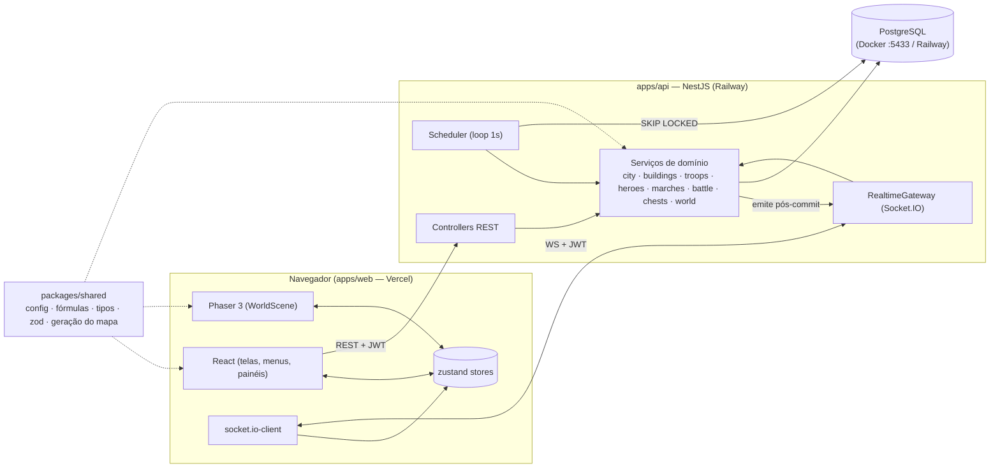
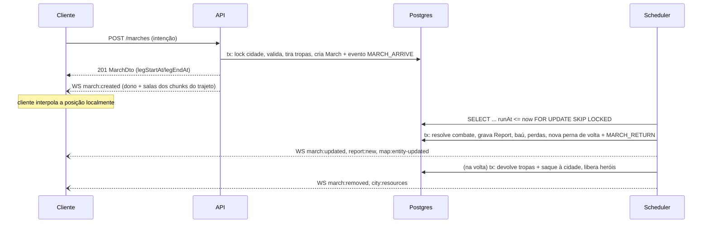

# Arquitetura — Warhammer Navigator (MMO-strategy de navegador)

> Documento de arquitetura do MVP. Os **números** (custos, tempos, atributos, drop de baús) vêm do GDD, que está sendo escrito em paralelo; aqui ficam a **forma** dos dados, os contratos e os fluxos. Onde aparece um valor, ele é placeholder e vive em `packages/shared/src/config`.

Sumário

1. Visão geral
2. Estrutura do monorepo
3. Schema Prisma (MVP)
4. Contratos REST e WebSocket
5. Fluxos detalhados
6. Front-end (React + Phaser)
7. Scripts e ambiente local
8. Segurança e antitrapaça
9. Deploy (Railway + Vercel)
10. Plano de implementação em etapas

---

## 1. Visão geral

Jogo de estratégia persistente para 10 a 50 amigos em **um único mundo** (grade ~120x120). Cada jogador tem uma cidade com prédios, produz recursos passivamente, treina tropas, recruta heróis e envia **marchas** pelo mapa para coletar, atacar NPC ou atacar outros jogadores. O combate é automático e resolvido no servidor quando a marcha chega.

Princípios:

| Princípio | Como se aplica |
|---|---|
| **Servidor autoritativo** | O cliente só envia intenções (`quero subir o prédio do slot 3`, `quero marchar para 40,52 com estas tropas`). Custos, tempos, posições, combate e saque são calculados no back. |
| **Avaliação preguiçosa (lazy)** | Recurso é `(valor, atualizadoEm)` e é calculado na leitura. Construção e treino guardam `endsAt` e são finalizados quando alguém lê/mexe na cidade **ou** pelo agendador (que existe para mandar o evento em tempo real). |
| **Agendador no Postgres** | Chegada/retorno/fim de coleta/respawn viram linhas em `scheduled_events`. Um loop de ~1s processa as vencidas com `FOR UPDATE SKIP LOCKED`, idempotente. |
| **Config compartilhada** | `packages/shared` tem as tabelas de números e as fórmulas puras. O back usa para decidir; o front usa para mostrar prévia (custo, tempo, posição da marcha) sem pedir ao servidor. |
| **Mapa por seed** | Terreno/bioma é função pura de `(seed, x, y)`. O banco guarda só o que tem estado: cidades, nós de recurso, acampamentos NPC, marchas. |
| **Tempo lógico** | Todo handler do agendador usa `event.runAt` como "agora" do jogo, e não o relógio da máquina. Um atraso de 2s no loop não muda o resultado. |



Ciclo de vida típico (marcha de ataque a NPC):



---

## 2. Estrutura do monorepo

```
warhammer-navigator/
├── package.json                  # scripts raiz (dev, db:*), devDeps: concurrently
├── pnpm-workspace.yaml           # apps/*, packages/*
├── docker-compose.yml            # só o Postgres (porta 5433)
├── .env.example                  # documenta as variáveis (cópias reais ficam em cada app)
├── .nvmrc                        # Node 22 LTS (ou superior)
├── docs/
│   ├── ARQUITETURA.md
│   └── GDD.md                    # números do jogo (game designer)
│
├── packages/
│   └── shared/                   # @wn/shared
│       ├── package.json          # exports: types -> src, require/import -> dist (tsup)
│       ├── tsup.config.ts        # cjs + esm, sem dts, sem type-check
│       ├── vitest.config.ts
│       └── src/
│           ├── index.ts
│           ├── ids.ts                    # BuildingTypeId, TroopTypeId, HeroTypeId, ItemId, ChestTypeId...
│           ├── config/
│           │   ├── index.ts              # GAME_CONFIG + CONFIG_VERSION
│           │   ├── world.ts              # tamanho, bandas de bioma, densidade de nós/camps, chunkSize
│           │   ├── buildings.ts          # BuildingDef por id, níveis (custo, duração, requisitos, efeitos)
│           │   ├── cityLayout.ts         # slots da cidade e tipos permitidos por slot
│           │   ├── troops.ts             # TroopDef (classe x tier): ataque, defesa, hp, velocidade, carga, custo, tempo
│           │   ├── heroes.ts             # HeroDef: canLead, bônus por nível, curva de XP
│           │   ├── npcCamps.ts           # CampDef por nível: tropas, saque, baú, respawn
│           │   ├── resourceNodes.ts      # NodeDef por tipo/nível: quantidade, taxa de coleta, respawn
│           │   ├── chests.ts             # ChestDef: tabela de recompensas
│           │   ├── items.ts              # ItemDef (ex.: livro de XP)
│           │   └── balance.ts            # constantes globais: escudo, % saque, limite de marchas, start kit
│           ├── formulas/                 # funções PURAS (sem Date.now, sem IO)
│           │   ├── resources.ts          # productionPerHour, capacity, settle, projectResources
│           │   ├── buildings.ts          # upgradeCost, upgradeDuration, cityLevel, requirementsMet
│           │   ├── training.ts           # trainingCost, trainingDuration, maxBatch
│           │   ├── march.ts              # distance, marchSpeed, travelMs, carryCapacity, maxMarches, positionAt
│           │   ├── gather.ts             # gatherDurationMs, gatheredAmount
│           │   ├── combat.ts             # resolveBattle(attacker, defender, seed) — determinístico
│           │   ├── loot.ts               # lootable, distributeLoot
│           │   ├── heroes.ts             # levelFromXp, xpToNext, heroBonuses
│           │   ├── shield.ts             # isShielded, shieldBreaksOnAttack
│           │   └── daily.ts              # nextDailyReset
│           ├── world/
│           │   ├── rng.ts                # mulberry32 + hashString (seed string -> uint32)
│           │   ├── noise.ts              # value noise 2D determinístico
│           │   ├── biome.ts              # biomeAt(seed, x, y), latitude -> banda
│           │   ├── generate.ts           # generateTerrain(seed,w,h), generateSpawns(seed) -> nós e camps
│           │   ├── chunks.ts             # chunkOf(x,y), chunkIdsInRect, chunksCrossedBySegment
│           │   └── geometry.ts           # dist, lerp, clamp
│           ├── contracts/
│           │   ├── common.ts             # Id, IsoDate, Resources, Coord, ChunkId
│           │   ├── errors.ts             # ErrorCode, ApiError
│           │   ├── rest.ts               # DTOs de request/response
│           │   ├── socket.ts             # ServerToClientEvents, ClientToServerEvents, SocketData
│           │   └── schemas.ts            # zod dos bodies (usado no back pra validar e no front nos forms)
│           └── __tests__/                # vitest das fórmulas e do gerador
│
└── apps/
    ├── api/                      # nome do pacote: "api"
    │   ├── package.json
    │   ├── .swcrc                # decorators legacy + decoratorMetadata (necessário pro DI do Nest)
    │   ├── nest-cli.json         # builder swc, typeCheck false
    │   ├── tsconfig.json         # só pro editor; não roda tsc
    │   ├── .env                  # local (não versionado)
    │   ├── prisma/
    │   │   ├── schema.prisma
    │   │   ├── migrations/       # gerado pelo dono ao rodar migrate dev
    │   │   └── seed.ts           # cria o World e materializa nós/camps a partir da seed
    │   └── src/
    │       ├── main.ts                   # bootstrap, CORS, helmet, ValidationPipe zod, porta 5001
    │       ├── app.module.ts
    │       ├── config/env.ts             # valida process.env com zod no boot
    │       ├── common/
    │       │   ├── prisma/prisma.module.ts
    │       │   ├── prisma/prisma.service.ts      # runInTx(fn) com EmitBuffer pós-commit
    │       │   ├── db/locks.ts                   # lockCity, lockCitiesOrdered, advisoryLock
    │       │   ├── clock/clock.service.ts        # now() injetável (testes)
    │       │   ├── errors/game-error.ts          # GameError(code, status, details)
    │       │   ├── filters/all-exceptions.filter.ts
    │       │   ├── guards/jwt-auth.guard.ts
    │       │   ├── decorators/current-player.decorator.ts
    │       │   └── pipes/zod-body.pipe.ts
    │       └── modules/
    │           ├── auth/        auth.module.ts · auth.controller.ts · auth.service.ts · tokens.service.ts
    │           ├── player/      player.module.ts · player.controller.ts · player.service.ts
    │           ├── world/       world.module.ts · world.controller.ts · world.service.ts
    │           │                placement.service.ts · chunk-query.service.ts · respawn.handlers.ts
    │           ├── city/        city.module.ts · city.controller.ts · city.service.ts
    │           │                city-tick.service.ts (finalização lazy) · city.mapper.ts
    │           ├── buildings/   buildings.module.ts · buildings.controller.ts · buildings.service.ts
    │           │                building-complete.handler.ts
    │           ├── troops/      troops.module.ts · troops.controller.ts · training.service.ts
    │           │                training-complete.handler.ts
    │           ├── heroes/      heroes.module.ts · heroes.controller.ts · heroes.service.ts
    │           ├── marches/     marches.module.ts · marches.controller.ts · marches.service.ts
    │           │                march-validator.ts · arrival.handler.ts · gather-complete.handler.ts
    │           │                return.handler.ts · march.mapper.ts
    │           ├── battle/      battle.module.ts · battle.service.ts (monta exércitos, chama shared, aplica perdas)
    │           │                reports.controller.ts · reports.service.ts
    │           ├── chests/      chests.module.ts · chests.controller.ts · chests.service.ts
    │           │                reward-roller.ts · inventory.service.ts
    │           ├── realtime/    realtime.module.ts · realtime.gateway.ts · realtime.service.ts
    │           │                socket-auth.middleware.ts · emit-buffer.ts
    │           ├── scheduler/   scheduler.module.ts · scheduler.service.ts (loop)
    │           │                event-queue.ts (interface EventQueue + PgEventQueue) · handler-registry.ts
    │           └── health/      health.controller.ts
    │
    └── web/                      # nome do pacote: "web"
        ├── package.json
        ├── vite.config.ts        # porta 5000 strictPort, alias @wn/shared -> ../../packages/shared/src
        ├── vercel.json           # rewrite SPA
        ├── index.html
        ├── .env                  # VITE_API_URL=http://localhost:5001
        └── src/
            ├── main.tsx · App.tsx · router.tsx
            ├── api/          http.ts (fetch + token + refresh automático) · endpoints.ts
            ├── realtime/     socket.ts (cliente tipado) · handlers.ts (evento -> store) · timeSync.ts
            ├── stores/       auth.ts · city.ts · world.ts · marches.ts · reports.ts · ui.ts · clock.ts
            ├── game/
            │   ├── PhaserHost.tsx            # monta o Phaser.Game uma vez e mantém vivo
            │   ├── phaserConfig.ts
            │   ├── bridge.ts                 # store <-> cena (subscribe vanilla do zustand + gameBus)
            │   ├── scenes/BootScene.ts · WorldScene.ts
            │   └── systems/TerrainLayer.ts · ChunkManager.ts · CameraController.ts
            │                EntityLayer.ts · MarchLayer.ts · SelectionMarker.ts
            ├── screens/      LoginScreen · RegisterScreen · CityScreen · MapScreen · ArmyScreen
            │                 (tropas + heróis) · ReportsScreen · ReportDetailScreen · ChestsScreen · RankingScreen
            ├── components/   ResourceBar · Countdown · BuildingSlot · BuildingPanel · TrainPanel
            │                 MarchDialog · TilePopup · MarchList · IncomingAttackBanner · Toasts · Modal
            ├── i18n/         errors.ts (ErrorCode -> texto pt-BR) · labels.ts (nomes de prédio/tropa)
            └── styles/
```

Notas de ferramenta (decisões que evitam dor):

- **API em dev com SWC, não com `tsx watch`.** O `tsx` usa esbuild, que **não emite `emitDecoratorMetadata`**: a injeção por construtor do Nest quebra (todo provider viria `undefined`). SWC emite metadata e não faz type-check. Ver scripts na seção 7.
- **`@wn/shared` sem `tsc`.** O `package.json` do shared aponta `types` para `src/index.ts` (o editor e o Vite leem o TS direto) e `require/import` para `dist/` gerado pelo **tsup** (esbuild, sem checagem). O web usa alias para `src` (HMR imediato); o api consome o `dist` CJS.
- **pnpm 10** bloqueia scripts de instalação por padrão: liberar `prisma`, `@prisma/client`, `@prisma/engines`, `esbuild` e `@swc/core` em `pnpm.onlyBuiltDependencies`.
- **bcryptjs** em vez de `bcrypt` nativo (evita node-gyp no Windows; desempenho irrelevante nessa escala).
- **Prisma 6** com `prisma-client-js` (sem o `prisma.config.ts`/adapters do Prisma 7, que podemos adotar depois).
- Validação de body com **zod** (schemas no shared, usados no back e nos formulários do front) em vez de class-validator: uma fonte só.

---

## 3. Schema Prisma (MVP)

Convenções:

- Tipos de prédio/tropa/herói/baú/item/acampamento são **string ids da config** (`"town_hall"`, `"infantry_t1"`, `"hero_aldric"`), não tabelas.
- Tabelas em snake_case (`@@map`), colunas em camelCase (em SQL raw, usar aspas: `"runAt"`).
- Todas as datas `timestamptz(3)`.
- Recursos guardados em `Float` (double) para não perder a fração da produção entre leituras; a UI arredonda para baixo.
- Uma linha de `World` (único mundo), mas tudo referencia `worldId` para permitir temporadas depois.

`apps/api/prisma/schema.prisma`:

```prisma
generator client {
  provider = "prisma-client-js"
}

datasource db {
  provider = "postgresql"
  url      = env("DATABASE_URL")
}

// ─────────────────────────── Enums ───────────────────────────

enum UserRole {
  PLAYER
  ADMIN
}

enum WorldStatus {
  ACTIVE
  PAUSED
  ENDED
}

enum ResourceType {
  FOOD
  WOOD
  STONE
  GOLD
}

enum ResourceNodeStatus {
  AVAILABLE // pode estar ocupado: ver occupiedByMarchId
  DEPLETED  // esgotado, aguardando respawn
}

enum NpcCampStatus {
  ACTIVE
  DEFEATED
}

enum MarchType {
  GATHER
  ATTACK_NPC
  ATTACK_PLAYER
}

enum MarchState {
  OUTBOUND  // indo até o alvo
  GATHERING // parada no nó coletando
  RETURNING // voltando para a cidade
  COMPLETED // chegou em casa (histórico)
}

enum MarchTargetKind {
  RESOURCE_NODE
  NPC_CAMP
  CITY
}

enum ReportKind {
  GATHER
  BATTLE_NPC
  BATTLE_PVP
}

enum ReportRole {
  ATTACKER
  DEFENDER
  GATHERER
}

enum BattleOutcome {
  ATTACKER_WON
  DEFENDER_WON
  DRAW
}

enum ChestSource {
  STARTER
  DAILY
  NPC_VICTORY
  ADMIN
}

enum ScheduledEventType {
  BUILDING_COMPLETE
  TRAINING_COMPLETE
  MARCH_ARRIVE
  GATHER_COMPLETE
  MARCH_RETURN
  NPC_CAMP_RESPAWN
  RESOURCE_NODE_RESPAWN
}

enum ScheduledEventStatus {
  PENDING
  DONE
  CANCELLED
  FAILED
}

// ─────────────────────────── Auth ───────────────────────────

model User {
  id                 String    @id @default(cuid())
  username           String // como foi digitado (exibição)
  usernameNormalized String    @unique // lower-case, usado no login
  passwordHash       String
  role               UserRole  @default(PLAYER)
  createdAt          DateTime  @default(now()) @db.Timestamptz(3)
  lastLoginAt        DateTime? @db.Timestamptz(3)

  player        Player?
  refreshTokens RefreshToken[]

  @@map("users")
}

model RefreshToken {
  id        String    @id @default(cuid())
  userId    String
  tokenHash String    @unique // sha256 do token opaco; o token em si nunca é salvo
  expiresAt DateTime  @db.Timestamptz(3)
  revokedAt DateTime? @db.Timestamptz(3)
  createdAt DateTime  @default(now()) @db.Timestamptz(3)

  user User @relation(fields: [userId], references: [id], onDelete: Cascade)

  @@index([userId])
  @@map("refresh_tokens")
}

// ─────────────────────────── Mundo ───────────────────────────

model World {
  id              String      @id @default(cuid())
  name            String
  seed            String // seed da geração determinística (shared/world)
  width           Int // 120
  height          Int // 120
  chunkSize       Int         @default(16)
  speedMultiplier Float       @default(1) // multiplicador global de velocidade
  configVersion   String // CONFIG_VERSION do shared no momento da criação
  status          WorldStatus @default(ACTIVE)
  startedAt       DateTime    @default(now()) @db.Timestamptz(3)

  players       Player[]
  cities        City[]
  resourceNodes ResourceNode[]
  npcCamps      NpcCamp[]
  marches       March[]
  reports       Report[]

  @@map("worlds")
}

model Player {
  id               String    @id @default(cuid())
  userId           String    @unique
  worldId          String
  displayName      String
  shieldUntil      DateTime? @db.Timestamptz(3) // escudo de novato
  lastDailyChestAt DateTime? @db.Timestamptz(3)
  power            Int       @default(0) // cache para ranking (recalculado em mudanças de tropa/prédio)
  createdAt        DateTime  @default(now()) @db.Timestamptz(3)

  user      User              @relation(fields: [userId], references: [id], onDelete: Cascade)
  world     World             @relation(fields: [worldId], references: [id])
  city      City?
  heroes    Hero[]
  chests    Chest[]
  inventory InventoryItem[]
  marches   March[]
  reports   ReportRecipient[]

  @@unique([worldId, displayName])
  @@index([worldId, power])
  @@map("players")
}

// ─────────────────────────── Cidade ───────────────────────────

model City {
  id                 String   @id @default(cuid())
  worldId            String
  playerId           String   @unique
  name               String
  x                  Int
  y                  Int
  level              Int      @default(1) // cache = nível do prédio principal (town_hall)
  food               Float    @default(0)
  wood               Float    @default(0)
  stone              Float    @default(0)
  gold               Float    @default(0)
  resourcesUpdatedAt DateTime @db.Timestamptz(3) // instante em que food/wood/stone/gold valiam isso
  createdAt          DateTime @default(now()) @db.Timestamptz(3)

  world           World         @relation(fields: [worldId], references: [id])
  player          Player        @relation(fields: [playerId], references: [id], onDelete: Cascade)
  buildings       Building[]
  troops          TroopStack[]
  trainingJobs    TrainingJob[]
  marches         March[]       @relation("MarchOrigin")
  incomingMarches March[]       @relation("MarchTargetCity")

  @@unique([worldId, x, y]) // também serve de índice para consulta por retângulo (chunk)
  @@map("cities")
}

model Building {
  id               String    @id @default(cuid())
  cityId           String
  slot             Int // posição no layout (config/cityLayout); slot 0 = town_hall
  typeId           String // BuildingTypeId da config
  level            Int       @default(0) // 0 = em construção pela primeira vez
  upgradeStartedAt DateTime? @db.Timestamptz(3)
  upgradeEndsAt    DateTime? @db.Timestamptz(3) // != null => upgrade em andamento para level + 1
  updatedAt        DateTime  @updatedAt @db.Timestamptz(3)

  city City @relation(fields: [cityId], references: [id], onDelete: Cascade)

  @@unique([cityId, slot])
  @@index([cityId, upgradeEndsAt])
  @@map("buildings")
}

/// Tropas em casa, disponíveis. Tropas em marcha ficam em MarchTroop.
model TroopStack {
  cityId      String
  troopTypeId String // ex.: "infantry_t1"
  count       Int    @default(0)

  city City @relation(fields: [cityId], references: [id], onDelete: Cascade)

  @@id([cityId, troopTypeId])
  @@map("troop_stacks")
}

/// Fila do quartel: jobs sequenciais (startsAt = max(agora, fim do último job)).
model TrainingJob {
  id          String    @id @default(cuid())
  cityId      String
  troopTypeId String
  count       Int
  startsAt    DateTime  @db.Timestamptz(3)
  endsAt      DateTime  @db.Timestamptz(3)
  completedAt DateTime? @db.Timestamptz(3) // != null => tropas já somadas ao TroopStack
  createdAt   DateTime  @default(now()) @db.Timestamptz(3)

  city City @relation(fields: [cityId], references: [id], onDelete: Cascade)

  @@index([cityId, completedAt, endsAt])
  @@map("training_jobs")
}

// ─────────────────────────── Heróis e itens ───────────────────────────

model Hero {
  id            String   @id @default(cuid())
  playerId      String
  heroTypeId    String // HeroTypeId da config (define se pode ser comandante: canLead)
  level         Int      @default(1)
  xp            Int      @default(0) // XP total acumulado; nível derivado pela curva do shared
  activeMarchId String? // != null => herói ocupado nessa marcha
  createdAt     DateTime @default(now()) @db.Timestamptz(3)

  player      Player      @relation(fields: [playerId], references: [id], onDelete: Cascade)
  activeMarch March?      @relation("HeroActiveMarch", fields: [activeMarchId], references: [id], onDelete: SetNull)
  marchSlots  MarchHero[]

  @@unique([playerId, heroTypeId]) // um herói de cada tipo por jogador
  @@index([activeMarchId])
  @@map("heroes")
}

model InventoryItem {
  playerId String
  itemId   String // ItemId da config (ex.: "xp_book_small")
  quantity Int    @default(0)

  player Player @relation(fields: [playerId], references: [id], onDelete: Cascade)

  @@id([playerId, itemId])
  @@map("inventory_items")
}

// ─────────────────────────── Entidades do mapa ───────────────────────────

model ResourceNode {
  id                String             @id @default(cuid())
  worldId           String
  x                 Int
  y                 Int
  resourceType      ResourceType
  level             Int
  maxAmount         Int
  remaining         Int
  status            ResourceNodeStatus @default(AVAILABLE)
  occupiedByMarchId String?            @unique // uma marcha coletando por vez
  respawnAt         DateTime?          @db.Timestamptz(3)
  generation        Int                @default(0) // incrementa a cada respawn (idempotência do evento)
  updatedAt         DateTime           @updatedAt @db.Timestamptz(3)

  world      World   @relation(fields: [worldId], references: [id])
  occupiedBy March?  @relation("NodeOccupant", fields: [occupiedByMarchId], references: [id], onDelete: SetNull)
  targetedBy March[] @relation("MarchTargetNode")

  @@unique([worldId, x, y])
  @@map("resource_nodes")
}

model NpcCamp {
  id            String        @id @default(cuid())
  worldId       String
  x             Int
  y             Int
  campTypeId    String // CampTypeId da config (define tropas, saque, baú)
  level         Int
  status        NpcCampStatus @default(ACTIVE)
  currentTroops Json? // { [troopTypeId]: count } das tropas restantes; null = cheio (valor da config)
  defeatedAt    DateTime?     @db.Timestamptz(3)
  respawnAt     DateTime?     @db.Timestamptz(3)
  generation    Int           @default(0)
  updatedAt     DateTime      @updatedAt @db.Timestamptz(3)

  world      World   @relation(fields: [worldId], references: [id])
  targetedBy March[] @relation("MarchTargetCamp")

  @@unique([worldId, x, y])
  @@index([status, respawnAt])
  @@map("npc_camps")
}

// ─────────────────────────── Marchas ───────────────────────────

model March {
  id           String     @id @default(cuid())
  worldId      String
  playerId     String
  originCityId String
  type         MarchType
  state        MarchState

  // alvo
  targetKind           MarchTargetKind
  targetX              Int
  targetY              Int
  targetResourceNodeId String?
  targetNpcCampId      String?
  targetCityId         String?

  // perna atual (o cliente interpola entre from e to usando legStartAt/legEndAt)
  fromX      Float
  fromY      Float
  toX        Float
  toY        Float
  legStartAt DateTime @db.Timestamptz(3)
  legEndAt   DateTime @db.Timestamptz(3)

  speed         Float // tiles por segundo, já com bônus de herói e multiplicador global
  carryCapacity Int // carga total das tropas vivas

  gatherStartedAt DateTime? @db.Timestamptz(3)
  gatherEndsAt    DateTime? @db.Timestamptz(3)

  // saque/coleta carregado de volta
  lootFood  Int @default(0)
  lootWood  Int @default(0)
  lootStone Int @default(0)
  lootGold  Int @default(0)

  version     Int       @default(0) // +1 a cada mudança de perna/estado; vai no payload do evento
  createdAt   DateTime  @default(now()) @db.Timestamptz(3)
  completedAt DateTime? @db.Timestamptz(3)

  world          World            @relation(fields: [worldId], references: [id])
  player         Player           @relation(fields: [playerId], references: [id], onDelete: Cascade)
  originCity     City             @relation("MarchOrigin", fields: [originCityId], references: [id], onDelete: Cascade)
  targetNode     ResourceNode?    @relation("MarchTargetNode", fields: [targetResourceNodeId], references: [id], onDelete: SetNull)
  targetCamp     NpcCamp?         @relation("MarchTargetCamp", fields: [targetNpcCampId], references: [id], onDelete: SetNull)
  targetCity     City?            @relation("MarchTargetCity", fields: [targetCityId], references: [id], onDelete: SetNull)
  occupiedNode   ResourceNode?    @relation("NodeOccupant")
  troops         MarchTroop[]
  heroes         MarchHero[]
  activeHeroes   Hero[]           @relation("HeroActiveMarch")
  events         ScheduledEvent[]

  @@index([worldId, state])
  @@index([playerId, state])
  @@index([targetCityId, state])
  @@map("marches")
}

model MarchTroop {
  marchId     String
  troopTypeId String
  sent        Int // quantas saíram
  alive       Int // quantas continuam vivas (atualizado após combate)

  march March @relation(fields: [marchId], references: [id], onDelete: Cascade)

  @@id([marchId, troopTypeId])
  @@map("march_troops")
}

model MarchHero {
  marchId String
  heroId  String
  slot    Int // 0 = comandante principal, 1 e 2 = secundários

  march March @relation(fields: [marchId], references: [id], onDelete: Cascade)
  hero  Hero  @relation(fields: [heroId], references: [id], onDelete: Cascade)

  @@id([marchId, slot])
  @@unique([marchId, heroId])
  @@index([heroId])
  @@map("march_heroes")
}

// ─────────────────────────── Relatórios e baús ───────────────────────────

model Report {
  id               String         @id @default(cuid())
  worldId          String
  kind             ReportKind
  outcome          BattleOutcome? // null em GATHER
  x                Int
  y                Int
  marchId          String? // sem FK: o relatório sobrevive à limpeza de marchas antigas
  attackerPlayerId String?
  defenderPlayerId String?
  payload          Json // BattleReportPayload | GatherReportPayload (shared/contracts/rest.ts)
  createdAt        DateTime       @default(now()) @db.Timestamptz(3)

  world      World             @relation(fields: [worldId], references: [id])
  recipients ReportRecipient[]

  @@index([worldId, createdAt])
  @@map("reports")
}

model ReportRecipient {
  reportId  String
  playerId  String
  role      ReportRole
  readAt    DateTime? @db.Timestamptz(3)
  createdAt DateTime  @default(now()) @db.Timestamptz(3)

  report Report @relation(fields: [reportId], references: [id], onDelete: Cascade)
  player Player @relation(fields: [playerId], references: [id], onDelete: Cascade)

  @@id([reportId, playerId])
  @@index([playerId, createdAt])
  @@map("report_recipients")
}

model Chest {
  id          String      @id @default(cuid())
  playerId    String
  chestTypeId String // ChestTypeId da config
  source      ChestSource
  sourceRef   String? // ex.: reportId da vitória que gerou o baú
  openedAt    DateTime?   @db.Timestamptz(3)
  rewards     Json? // ChestRewardDto[] sorteadas na abertura (auditoria)
  createdAt   DateTime    @default(now()) @db.Timestamptz(3)

  player Player @relation(fields: [playerId], references: [id], onDelete: Cascade)

  @@index([playerId, openedAt])
  @@map("chests")
}

// ─────────────────────────── Agendador ───────────────────────────

model ScheduledEvent {
  id          String               @id @default(cuid())
  type        ScheduledEventType
  status      ScheduledEventStatus @default(PENDING)
  runAt       DateTime             @db.Timestamptz(3)
  payload     Json // ex.: { marchId, version } | { cityId, buildingId, level } | { campId, generation }
  dedupeKey   String               @unique // ex.: "march:<id>:v3:arrive" — impede agendar duas vezes
  marchId     String?
  attempts    Int                  @default(0)
  lastError   String?
  createdAt   DateTime             @default(now()) @db.Timestamptz(3)
  processedAt DateTime?            @db.Timestamptz(3)

  march March? @relation(fields: [marchId], references: [id], onDelete: Cascade)

  @@index([status, runAt])
  @@map("scheduled_events")
}
```

Por que essas escolhas:

- **`Building.upgradeEndsAt` em vez de tabela de fila:** MVP tem 1 obra por vez (o limite vem da config, `buildQueueSize`). Se o GDD pedir fila longa, cria-se `ConstructionJob` igual ao `TrainingJob`.
- **`Hero.activeMarchId` + `MarchHero`:** o primeiro responde rápido "herói está livre?" (com a cidade travada, não há corrida); o segundo guarda o slot (comandante/secundário) e alimenta o relatório.
- **`March.version` + `ScheduledEvent.dedupeKey`:** idempotência. Todo evento carrega a versão da marcha; se a marcha mudou (recall, por exemplo), o evento velho vira no-op.
- **`NpcCamp.currentTroops` (Json):** permite que um acampamento fique "ferido" depois de um ataque fracassado. `null` = cheio.
- **Sem tabela de tiles:** bioma/terreno é calculado pela seed (ver 5.9).

---

## 4. Contratos

Todos os tipos abaixo moram em `packages/shared/src/contracts` e são importados como `import type { ... } from '@wn/shared'`.

### 4.1 Tipos comuns e erros

```ts
// contracts/common.ts
export type Id = string;
export type IsoDate = string; // ISO 8601 UTC, ex.: "2026-11-23T14:03:12.511Z"
export type ResourceKey = 'food' | 'wood' | 'stone' | 'gold';
export type Resources = Record<ResourceKey, number>;
export interface Coord { x: number; y: number }
export type ChunkId = `${number}:${number}`; // "cx:cy"

export type MarchType = 'GATHER' | 'ATTACK_NPC' | 'ATTACK_PLAYER';
export type MarchState = 'OUTBOUND' | 'GATHERING' | 'RETURNING' | 'COMPLETED';
export type MarchTargetKind = 'RESOURCE_NODE' | 'NPC_CAMP' | 'CITY';
export type ReportKind = 'GATHER' | 'BATTLE_NPC' | 'BATTLE_PVP';
export type ReportRole = 'ATTACKER' | 'DEFENDER' | 'GATHERER';
export type BattleOutcome = 'ATTACKER_WON' | 'DEFENDER_WON' | 'DRAW';
export type ChestSource = 'STARTER' | 'DAILY' | 'NPC_VICTORY' | 'ADMIN';
export type Biome = 'GRASSLAND' | 'DESERT' | 'TUNDRA' | 'ICE';

// ids.ts — derivados da config, então erro de digitação vira erro de tipo
export type BuildingTypeId = keyof typeof BUILDINGS;   // 'town_hall' | 'farm' | 'lumber_mill' | 'quarry' | 'gold_mine' | 'warehouse' | 'barracks' | 'wall' | ...
export type TroopTypeId = keyof typeof TROOPS;         // 'infantry_t1' | 'archer_t1' | 'cavalry_t1' | ...
export type HeroTypeId = keyof typeof HEROES;
export type ItemId = keyof typeof ITEMS;
export type ChestTypeId = keyof typeof CHESTS;
export type CampTypeId = keyof typeof NPC_CAMPS;
```

```ts
// contracts/errors.ts
export type ErrorCode =
  | 'VALIDATION_FAILED'
  | 'UNAUTHORIZED'
  | 'FORBIDDEN'
  | 'NOT_FOUND'
  | 'RATE_LIMITED'
  | 'USERNAME_TAKEN'
  | 'INVALID_CREDENTIALS'
  | 'WORLD_FULL'
  | 'INSUFFICIENT_RESOURCES'
  | 'BUILD_QUEUE_FULL'
  | 'REQUIREMENT_NOT_MET'
  | 'MAX_LEVEL_REACHED'
  | 'SLOT_TYPE_NOT_ALLOWED'
  | 'TRAINING_QUEUE_FULL'
  | 'TROOP_LOCKED'            // tier não liberado pelo nível do quartel
  | 'COMMANDER_REQUIRED'
  | 'HERO_CANNOT_LEAD'
  | 'HERO_BUSY'
  | 'TOO_MANY_HEROES'
  | 'NOT_ENOUGH_TROOPS'
  | 'NO_TROOPS'
  | 'MARCH_LIMIT_REACHED'
  | 'TARGET_INVALID'          // nada daquele tipo naquela coordenada
  | 'TARGET_OWN_CITY'
  | 'TARGET_SHIELDED'
  | 'TARGET_DEPLETED'
  | 'MARCH_NOT_RECALLABLE'
  | 'CHEST_ALREADY_OPENED'
  | 'DAILY_CHEST_NOT_READY'
  | 'NOT_ENOUGH_ITEMS'
  | 'INTERNAL';

export interface ApiError {
  statusCode: number;
  code: ErrorCode;
  message: string;                    // técnico, em inglês (log); a tela usa i18n/errors.ts pelo code
  details?: Record<string, unknown>;  // ex.: { missing: Resources } em INSUFFICIENT_RESOURCES
}
```

### 4.2 DTOs

```ts
// contracts/rest.ts

// ── Auth ──
export interface RegisterRequest { username: string; password: string; cityName: string }
export interface LoginRequest { username: string; password: string }
export interface RefreshRequest { refreshToken: string }
export interface AuthResponse {
  accessToken: string;
  accessTokenExpiresAt: IsoDate;
  refreshToken: string;
  player: PlayerSelfDto;
}

// ── Jogador ──
export interface PlayerSelfDto {
  id: Id;
  username: string;
  displayName: string;
  cityId: Id;
  shieldUntil: IsoDate | null;
  dailyChestAvailableAt: IsoDate; // <= serverTime => pode pegar
  createdAt: IsoDate;
}
export interface PlayerListItemDto {
  id: Id; displayName: string; cityId: Id; cityName: string;
  cityLevel: number; power: number; x: number; y: number;
}

// ── Mundo ──
export interface WorldInfoDto {
  id: Id; name: string; seed: string;
  width: number; height: number; chunkSize: number;
  speedMultiplier: number;
  configVersion: string; // front compara com CONFIG_VERSION do bundle e avisa "recarregue a página"
  serverTime: IsoDate;
}
export interface MapCityDto {
  id: Id; x: number; y: number; name: string; level: number;
  ownerId: Id; ownerName: string; shielded: boolean;
}
export interface MapResourceNodeDto {
  id: Id; x: number; y: number; resourceType: ResourceKey; level: number;
  remaining: number; maxAmount: number;
  status: 'AVAILABLE' | 'DEPLETED';
  occupiedByPlayerName: string | null;
  respawnAt: IsoDate | null;
}
export interface MapNpcCampDto {
  id: Id; x: number; y: number; campTypeId: CampTypeId; level: number;
  status: 'ACTIVE' | 'DEFEATED';
  healthRatio: number; // 0..1 (tropas restantes / cheio) — não revela composição
  respawnAt: IsoDate | null;
}
/** Visão pública de uma marcha no mapa (sem composição de tropas de outros jogadores). */
export interface MapMarchDto {
  id: Id; ownerId: Id; ownerName: string; isMine: boolean;
  type: MarchType; state: MarchState; targetKind: MarchTargetKind;
  fromX: number; fromY: number; toX: number; toY: number;
  legStartAt: IsoDate; legEndAt: IsoDate;
}
export interface ChunkStateDto {
  chunkId: ChunkId;
  cities: MapCityDto[];
  resourceNodes: MapResourceNodeDto[];
  npcCamps: MapNpcCampDto[];
}
export interface ChunksResponse {
  chunks: ChunkStateDto[];
  marches: MapMarchDto[]; // marchas cuja perna atual cruza algum dos chunks pedidos (sem duplicar)
  serverTime: IsoDate;
}
export interface TileDetailDto {
  x: number; y: number; biome: Biome; chunkId: ChunkId;
  city: MapCityDto | null;
  resourceNode: MapResourceNodeDto | null;
  npcCamp: (MapNpcCampDto & { recommendedPower: number }) | null;
  travelMsFromMyCity: number | null; // prévia com a velocidade base
}

// ── Cidade ──
export interface BuildingDto {
  id: Id; slot: number; typeId: BuildingTypeId; level: number;
  upgradeStartedAt: IsoDate | null; upgradeEndsAt: IsoDate | null;
}
export interface TrainingJobDto {
  id: Id; troopTypeId: TroopTypeId; count: number; startsAt: IsoDate; endsAt: IsoDate;
}
export interface CityStateDto {
  id: Id; name: string; x: number; y: number; level: number;
  resources: Resources;       // valor já liquidado em resourcesAt
  resourcesAt: IsoDate;
  productionPerHour: Resources; // já com speedMultiplier — front projeta com shared/formulas/resources.projectResources
  capacity: Resources;
  buildings: BuildingDto[];
  troopsHome: Partial<Record<TroopTypeId, number>>;
  trainingQueue: TrainingJobDto[];
  buildQueue: { active: number; max: number };
  marchSlots: { active: number; max: number };
  serverTime: IsoDate;
}
export interface RenameCityRequest { name: string }
export interface UpgradeBuildingRequest { typeId?: BuildingTypeId } // obrigatório só se o slot está vazio
export interface TrainTroopsRequest { troopTypeId: TroopTypeId; count: number }

// ── Heróis e inventário ──
export interface HeroDto {
  id: Id; heroTypeId: HeroTypeId; level: number; xp: number;
  xpForNextLevel: number | null; // null = nível máximo
  canLead: boolean;
  activeMarchId: Id | null;
  bonuses: HeroBonuses; // calculado no shared a partir de tipo + nível
}
export interface HeroBonuses { attackPct: number; defensePct: number; hpPct: number; speedPct: number; loadPct: number; gatherPct: number }
export interface UseItemRequest { itemId: ItemId; quantity: number }
export interface InventoryItemDto { itemId: ItemId; quantity: number }

// ── Marchas ──
export interface CreateMarchRequest {
  type: MarchType;
  targetX: number;
  targetY: number;
  commanderHeroId: Id;
  secondaryHeroIds: Id[]; // 0..2
  troops: Partial<Record<TroopTypeId, number>>;
}
export interface MarchDto extends MapMarchDto {
  originCityId: Id;
  targetX: number; targetY: number;
  targetId: Id | null;
  troops: { troopTypeId: TroopTypeId; sent: number; alive: number }[];
  heroes: { heroId: Id; heroTypeId: HeroTypeId; slot: 0 | 1 | 2 }[];
  speed: number; carryCapacity: number;
  gatherEndsAt: IsoDate | null;
  loot: Resources;
  createdAt: IsoDate;
}

// ── Relatórios ──
export interface ReportSummaryDto {
  id: Id; kind: ReportKind; role: ReportRole; outcome: BattleOutcome | null;
  x: number; y: number; createdAt: IsoDate; readAt: IsoDate | null;
  opponentName: string | null; // jogador ou nome do acampamento
}
export interface BattleSideReport {
  name: string; playerId: Id | null;
  heroes: { heroTypeId: HeroTypeId; level: number; xpGained: number }[];
  troops: { troopTypeId: TroopTypeId; before: number; lost: number; after: number }[];
  powerBefore: number; powerAfter: number;
}
export interface BattleReportPayload {
  seed: number; rounds: number;
  attacker: BattleSideReport; defender: BattleSideReport;
  loot: Resources;               // o que o atacante levou
  chestTypeId: ChestTypeId | null;
}
export interface GatherReportPayload {
  resourceType: ResourceKey; amount: number; nodeLevel: number; durationMs: number; recalled: boolean;
}
export type ReportDetailDto = ReportSummaryDto & (
  | { kind: 'GATHER'; payload: GatherReportPayload }
  | { kind: 'BATTLE_NPC' | 'BATTLE_PVP'; payload: BattleReportPayload }
);
export interface Page<T> { items: T[]; nextCursor: string | null }

// ── Baús ──
export interface ChestDto { id: Id; chestTypeId: ChestTypeId; source: ChestSource; createdAt: IsoDate }
export type ChestRewardDto =
  | { kind: 'resources'; resources: Partial<Resources> }
  | { kind: 'troops'; troopTypeId: TroopTypeId; count: number }
  | { kind: 'item'; itemId: ItemId; quantity: number }
  | { kind: 'hero'; heroTypeId: HeroTypeId; duplicateConvertedTo: { itemId: ItemId; quantity: number } | null };
export interface OpenChestResponse { chestId: Id; rewards: ChestRewardDto[]; city: CityStateDto }
export interface DailyChestStatusDto { available: boolean; availableAt: IsoDate }
```

### 4.3 Rotas REST

Base: `http://localhost:5001/api`. Todas exigem `Authorization: Bearer <accessToken>`, exceto as marcadas como públicas. Erro sempre no formato `ApiError`.

| Método | Rota | Body | Resposta | Observações |
|---|---|---|---|---|
| GET | `/health` | — | `{ ok: true, time }` | pública |
| POST | `/auth/register` | `RegisterRequest` | `201 AuthResponse` | pública; cria user, player, cidade, herói inicial, baú inicial, escudo |
| POST | `/auth/login` | `LoginRequest` | `AuthResponse` | pública; rate limit forte |
| POST | `/auth/refresh` | `RefreshRequest` | `AuthResponse` | pública; rotaciona o refresh token |
| POST | `/auth/logout` | `RefreshRequest` | `204` | revoga o refresh token |
| GET | `/me` | — | `PlayerSelfDto` | |
| GET | `/players` | — | `PlayerListItemDto[]` | ranking por power |
| GET | `/world` | — | `WorldInfoDto` | |
| GET | `/world/chunks?ids=3:4,3:5` | — | `ChunksResponse` | máx. 36 ids por chamada |
| GET | `/world/tiles/:x/:y` | — | `TileDetailDto` | popup do clique no mapa |
| GET | `/city` | — | `CityStateDto` | finaliza obras/treinos vencidos (lazy) antes de responder |
| PATCH | `/city` | `RenameCityRequest` | `CityStateDto` | |
| GET | `/cities/:id` | — | `MapCityDto` | cidade de outro jogador (visão pública) |
| POST | `/city/buildings/:slot/upgrade` | `UpgradeBuildingRequest` | `CityStateDto` | constrói (slot vazio) ou sobe nível |
| POST | `/city/troops/train` | `TrainTroopsRequest` | `CityStateDto` | entra no fim da fila do quartel |
| GET | `/heroes` | — | `HeroDto[]` | |
| POST | `/heroes/:id/use-item` | `UseItemRequest` | `HeroDto` | ex.: livro de XP |
| GET | `/inventory` | — | `InventoryItemDto[]` | |
| GET | `/marches` | — | `MarchDto[]` | marchas ativas do jogador |
| GET | `/marches/:id` | — | `MarchDto` | só do dono |
| POST | `/marches` | `CreateMarchRequest` | `201 MarchDto` | validações em 5.4 |
| POST | `/marches/:id/recall` | — | `MarchDto` | OUTBOUND ou GATHERING → RETURNING |
| GET | `/reports?cursor=&limit=20` | — | `Page<ReportSummaryDto>` | |
| GET | `/reports/:id` | — | `ReportDetailDto` | só destinatários |
| POST | `/reports/:id/read` | — | `204` | |
| GET | `/chests` | — | `ChestDto[]` | baús fechados |
| GET | `/chests/daily` | — | `DailyChestStatusDto` | |
| POST | `/chests/daily/claim` | — | `ChestDto` | |
| POST | `/chests/:id/open` | — | `OpenChestResponse` | sorteio no servidor |
| POST | `/city/buildings/:slot/cancel` | — | `CityStateDto` | cancela a obra do lote, devolve 50% (`NOTHING_TO_CANCEL`) |
| POST | `/city/troops/heal` | `HealTroopsRequest` | `CityStateDto` | Enfermaria (fila de cura, `HEALING_COMPLETE`) |
| POST | `/city/speedup` | `UseSpeedupRequest` | `CityStateDto` | acelerador do inventário em obra/treino/cura |
| PUT | `/city/defense-hero` | `SetDefenseHeroRequest` | `CityStateDto` | comandante de defesa (exige Salão ≥ 1) |
| GET | `/heroes/fragments` | — | `HeroFragmentDto[]` | |
| POST | `/heroes/unlock` | `UnlockHeroRequest` | `HeroDto` | libera herói por fragmentos (excedente vira XP) |
| GET | `/tavern` | — | `TavernStatusDto` | |
| POST | `/tavern/summon` | `SummonRequest` | `SummonResponse` | chamado grátis (1/dia) ou pago em ouro; exige Salão ≥ 1 |

Notas da implementação: `POST /auth/logout` é pública (só precisa do refresh token). Marchas `REINFORCE` usam o mesmo `POST /marches` (alvo = cidade de outro jogador; ficam `STATIONED` até o recall).

### 4.4 Eventos WebSocket (Socket.IO)

Conexão: `io(VITE_WS_URL, { transports: ['websocket'], auth: { token: accessToken } })`, mesmo host/porta do HTTP (5001). Namespace padrão `/`.

Salas:

- `player:{playerId}`: entra automaticamente ao conectar. Tudo que é pessoal.
- `chunk:{cx}:{cy}`: o cliente pede via `chunks:subscribe` (substitui o conjunto anterior). Tudo que é visível no mapa.

Não há broadcast de posição por segundo: a posição é interpolada no cliente a partir de `legStartAt/legEndAt` (ver 5.8). Só mandamos evento quando a perna muda.

```ts
// contracts/socket.ts
export interface ServerToClientEvents {
  // mapa (salas de chunk; marchas também vão para player:{dono})
  'march:created':  (p: { march: MapMarchDto }) => void;
  'march:updated':  (p: { march: MapMarchDto }) => void;  // nova perna/estado: chegou, coletando, voltando, recall
  'march:removed':  (p: { marchId: Id }) => void;           // voltou para casa
  'map:entity-updated': (p:
    | { kind: 'city'; entity: MapCityDto }
    | { kind: 'resourceNode'; entity: MapResourceNodeDto }
    | { kind: 'npcCamp'; entity: MapNpcCampDto }) => void;

  // pessoais (player:{id})
  'march:arrived':    (p: { marchId: Id; result: 'GATHERING' | 'BATTLE' | 'TARGET_GONE' | 'TARGET_SHIELDED' | 'NODE_OCCUPIED' }) => void;
  'attack:incoming':  (p: { marchId: Id; attackerName: string; fromX: number; fromY: number; arriveAt: IsoDate }) => void;
  'attack:cancelled': (p: { marchId: Id }) => void; // atacante deu recall
  'report:new':       (p: { report: ReportSummaryDto }) => void;
  'city:resources':   (p: { resources: Resources; resourcesAt: IsoDate; productionPerHour: Resources; capacity: Resources }) => void;
  'city:troops':      (p: { troopsHome: Partial<Record<TroopTypeId, number>> }) => void;
  'building:completed': (p: { building: BuildingDto; cityLevel: number }) => void;
  'training:completed': (p: { jobId: Id; troopTypeId: TroopTypeId; count: number }) => void;
  'hero:updated':     (p: { hero: HeroDto }) => void;
  'chest:new':        (p: { chest: ChestDto }) => void;
  'shield:changed':   (p: { shieldUntil: IsoDate | null }) => void;

  // sistema
  'server:error':     (p: { code: ErrorCode }) => void; // ex.: token expirado -> cliente renova e reconecta
}

export interface ClientToServerEvents {
  'chunks:subscribe': (
    p: { chunkIds: ChunkId[] },                       // máx. 36
    ack: (r: { ok: true; chunkIds: ChunkId[] } | { ok: false; code: ErrorCode }) => void,
  ) => void;
  'time:sync': (ack: (r: { serverTime: number }) => void) => void; // epoch ms
}

export interface SocketData { userId: Id; playerId: Id; chunkIds: ChunkId[] }
```

No Nest: `@WebSocketGateway({ cors: { origin: CORS_ORIGINS, credentials: true }, transports: ['websocket'] })` com `Server<ClientToServerEvents, ServerToClientEvents, {}, SocketData>`. O `RealtimeService` expõe `toPlayer(playerId, ev, payload)` e `toChunks(chunkIds, ev, payload)`.

**Emissão só depois do commit:** serviços não chamam o gateway direto; empilham emissões num `EmitBuffer` que o `PrismaService.runInTx` descarrega depois que a transação confirma. Rollback = nada é emitido.

```ts
// common/prisma/prisma.service.ts (forma)
async runInTx<T>(fn: (tx: Tx, emit: EmitBuffer) => Promise<T>): Promise<T> {
  const emit = new EmitBuffer();
  const result = await this.$transaction((tx) => fn(tx, emit), { timeout: 10_000, maxWait: 5_000 });
  emit.flush(this.realtime);
  return result;
}
```

---

## 5. Fluxos

Helpers usados em todos os fluxos:

- `lockCity(tx, cityId)`: `SELECT id FROM cities WHERE id = $1 FOR UPDATE`. Toda escrita na cidade (recurso, tropas, prédios, heróis do dono) passa por aqui primeiro.
- `lockCitiesOrdered(tx, [a, b])`: trava duas cidades em ordem de id (PvP), evitando deadlock.
- `CityTickService.advance(tx, city, at)`: a **finalização lazy**:

```
advance(city, at):
  timeline = obras com upgradeEndsAt <= at  ∪  treinos com endsAt <= at e completedAt null
  ordenar por instante
  para cada item:
    settle(city, item.instante)        // produz com as taxas ANTERIORES ao item
    aplicar item (level++ | troops += count, completedAt = instante)
  settle(city, at)
  city.level = nível do town_hall
  devolve a lista do que finalizou (vira building:completed / training:completed pós-commit)

settle(city, t):
  t = max(t, city.resourcesUpdatedAt)                 // nunca volta no tempo
  h = (t - resourcesUpdatedAt) / 3_600_000
  para cada recurso r:
    if valor[r] < cap[r]: valor[r] = min(cap[r], valor[r] + prod[r] * h)   // acima do cap (saque) não perde
  resourcesUpdatedAt = t
```

`prod` e `cap` vêm de `shared/formulas/resources.ts` a partir dos níveis dos prédios e de `world.speedMultiplier`.

### 5.1 Cadastro → criação da cidade

1. `POST /auth/register` valida com zod (`username` 3–20 `[a-zA-Z0-9_]`, `password` 8–72, `cityName` 3–24).
2. Transação:
   1. `INSERT users` (`usernameNormalized` = lower). Violação de unique → `USERNAME_TAKEN`.
   2. `INSERT players` (`displayName` = username, `shieldUntil = now + NEWBIE_SHIELD_MS / speed`).
   3. `SELECT pg_advisory_xact_lock(hashtext('city-placement:' || worldId))` — serializa só o posicionamento.
   4. **Escolha da posição** (`PlacementService`):
      - candidatos = tiles cuja latitude cai na banda verde (`biomeAt(seed,x,y) === 'GRASSLAND'`) e que não sejam borda;
      - sorteia até 300 candidatos com `crypto.randomInt`; aceita o primeiro que: não tem cidade/nó/camp no raio 1 e fica a ≥ `MIN_CITY_DISTANCE` (config, ex.: 4) de outra cidade;
      - consulta: cidades/nós/camps num retângulo pequeno via índice `(worldId, x, y)`;
      - sem candidato → varredura espiral a partir do centro; ainda sem → `WORLD_FULL` (503).
   5. `INSERT cities` com recursos iniciais (`balance.startKit`), `resourcesUpdatedAt = now`.
   6. `INSERT buildings` do kit inicial (town_hall 1, fazenda 1, serraria 1, ...; slots de `cityLayout`).
   7. `INSERT troop_stacks` iniciais, `INSERT heroes` (comandante inicial, `canLead = true`), `INSERT chests` (`STARTER`).
   8. `INSERT refresh_tokens`.
3. Pós-commit: `map:entity-updated { kind: 'city' }` para a sala do chunk da cidade.
4. Responde `AuthResponse`. O front vai para a tela da cidade.

### 5.2 Upgrade de prédio

`POST /city/buildings/:slot/upgrade { typeId? }`

1. tx → `lockCity` → `advance(city, now)`.
2. Validações (todas com fórmulas do shared):
   - slot existe no `cityLayout`; se vazio, `typeId` obrigatório e permitido no slot (`SLOT_TYPE_NOT_ALLOWED`); tipos únicos (town_hall, warehouse...) não duplicam;
   - `level < maxLevel` (`MAX_LEVEL_REACHED`);
   - nenhum prédio com `upgradeEndsAt != null` além do limite `buildQueueSize` (`BUILD_QUEUE_FULL`);
   - requisitos do próximo nível (ex.: `town_hall >= n`) (`REQUIREMENT_NOT_MET`);
   - recursos ≥ custo (`INSUFFICIENT_RESOURCES`, `details.missing`).
3. Debita custo (o settle já foi feito no `advance`), cria/atualiza `Building` com `upgradeStartedAt = now`, `upgradeEndsAt = now + duration / speed`.
4. Agenda `BUILDING_COMPLETE` em `upgradeEndsAt`, `dedupeKey = building:{id}:L{level+1}`.
5. Resposta `CityStateDto` (o front mostra a contagem regressiva).
6. Quando vence: quem chegar primeiro finaliza — um `GET /city` (lazy) ou o handler do evento, que só chama `advance(city, event.runAt)`. Se já foi finalizado, o handler não encontra nada vencido e termina como `DONE` (no-op). Quem finaliza emite `building:completed` e, se mudou produção/capacidade, `city:resources`.

O nível da vila (`City.level`) é o nível do `town_hall`, recalculado no `advance`.

### 5.3 Treino de tropa

`POST /city/troops/train { troopTypeId, count }`

1. tx → `lockCity` → `advance`.
2. Valida: `troopTypeId` existe; tier liberado pelo nível do quartel (`TROOP_LOCKED`); `1 <= count <= maxBatch(barracksLevel)`; fila `< trainingQueueSize` (`TRAINING_QUEUE_FULL`); recursos (`INSUFFICIENT_RESOURCES`).
3. Debita; `startsAt = max(now, endsAt do último job não concluído)`; `endsAt = startsAt + count * unitTime / speed`.
4. Agenda `TRAINING_COMPLETE` (`dedupeKey = training:{jobId}`).
5. Conclusão lazy ou pelo evento (mesmo padrão do 5.2): soma em `TroopStack`, `completedAt = endsAt`, emite `training:completed` + `city:troops`.

Tropas entram inteiras no fim do lote (MVP). Cancelamento de treino fica fora do MVP.

### 5.4 Criar marcha

`POST /marches { type, targetX, targetY, commanderHeroId, secondaryHeroIds, troops }`

Transação, nesta ordem:

1. `lockCity(origem)` → `advance(origem, now)`.
2. **Alvo** (resolvido pela coordenada, nunca por id vindo do cliente):
   - `targetX/Y` inteiros dentro do mapa;
   - `GATHER` → existe `ResourceNode` `AVAILABLE` ali (`TARGET_INVALID` / `TARGET_DEPLETED`). Ocupado não bloqueia a saída (pode liberar até a chegada); é checado na chegada;
   - `ATTACK_NPC` → existe `NpcCamp` `ACTIVE` ali;
   - `ATTACK_PLAYER` → existe `City` ali, não é a própria (`TARGET_OWN_CITY`), dono sem escudo ativo (`TARGET_SHIELDED`).
3. **Comandante obrigatório:** `commanderHeroId` presente (`COMMANDER_REQUIRED`), do jogador, `canLead` na config (`HERO_CANNOT_LEAD`).
4. **Heróis:** `secondaryHeroIds.length <= 2` (`TOO_MANY_HEROES`), sem repetidos, todos do jogador, todos com `activeMarchId == null` (`HERO_BUSY`).
5. **Tropas:** pelo menos 1 tropa (`NO_TROOPS`); cada `count` inteiro > 0 e `<= TroopStack.count` (`NOT_ENOUGH_TROOPS`).
6. **Limite de marchas:** marchas do jogador com `state != COMPLETED` `< maxMarches(city.level)` (`MARCH_LIMIT_REACHED`).
7. **Escudo:** se `type === 'ATTACK_PLAYER'` e o atacante tem escudo, ele **perde o escudo** (`shieldUntil = now`, regra `shieldBreaksOnAttack` do balance; confirmar no GDD) e recebe `shield:changed`.
8. Cálculos (shared): `speed = marchSpeed(tropas, heróis, world.speed)` (a tropa mais lenta manda), `travelMs = distance(origem, alvo) / speed`, `carryCapacity`.
9. Escritas: debita `TroopStack`; cria `March` (`state = OUTBOUND`, `from = cidade`, `to = alvo`, `legStartAt = now`, `legEndAt = now + travelMs`, `version = 0`), `MarchTroop[]`, `MarchHero[]` (slot 0 = comandante); `Hero.activeMarchId = march.id`.
10. Agenda `MARCH_ARRIVE` em `legEndAt` com `payload { marchId, version: 0 }`, `dedupeKey = march:{id}:v0:arrive`.
11. Pós-commit: `march:created` para `player:{dono}` + salas de `chunksCrossedBySegment(from, to)`; `city:troops`; em PvP, `attack:incoming` para `player:{defensor}`.

**Recall** (`POST /marches/:id/recall`): só do dono; `OUTBOUND` → posição atual = `positionAt(now)` vira `from`, `to = cidade`, nova perna; `GATHERING` → calcula o coletado parcial (5.5) e libera o nó. Em ambos: `version++`, `state = RETURNING`, evento antigo `CANCELLED`, agenda `MARCH_RETURN`. Em PvP, emite `attack:cancelled` ao defensor.

### 5.5 Processamento de chegada

Handler `MARCH_ARRIVE` (tempo lógico `T = event.runAt`). Primeiro: carrega a marcha; se `march.version != payload.version` ou `state != OUTBOUND` → no-op. Depois, por tipo:

**Coleta (`GATHER`)**

1. `SELECT ... FROM resource_nodes WHERE x,y FOR UPDATE`.
2. Nó `DEPLETED` ou não existe → `TARGET_GONE`, inicia retorno. Ocupado por outra marcha → `NODE_OCCUPIED`, inicia retorno (combate em nó fica fora do MVP).
3. Ocupa: `occupiedByMarchId = march.id`; `amount = min(node.remaining, carryCapacity)`; `gatherEndsAt = T + gatherDurationMs(amount, nodeLevel, heróis, speed)`; `state = GATHERING`, `version++`, perna parada (`from = to = alvo`).
4. Agenda `GATHER_COMPLETE` em `gatherEndsAt`. Emite `march:updated`, `march:arrived { result: 'GATHERING' }`, `map:entity-updated` (nó ocupado).

Handler `GATHER_COMPLETE` (ou recall durante a coleta, com `T = now`):

1. Trava o nó; `gathered = gatheredAmount(T - gatherStartedAt, taxa)` limitado a `node.remaining` e `carryCapacity`.
2. `node.remaining -= gathered`, `occupiedByMarchId = null`; se zerou → `DEPLETED`, `respawnAt = T + respawn/speed`, agenda `RESOURCE_NODE_RESPAWN` (`dedupeKey = node:{id}:g{generation}:respawn`).
3. `march.loot<Tipo> += gathered`; grava `Report GATHER` (destinatário `GATHERER`); inicia retorno.

**Ataque a NPC (`ATTACK_NPC`)**

1. Trava o camp. `DEFEATED` → `TARGET_GONE`, retorno.
2. Monta exércitos: atacante = `MarchTroop.alive` + bônus dos heróis (níveis); defensor = `currentTroops ?? config(campType).troops`.
3. `resolveBattle(attacker, defender, seed = hash(march.id, version))` do shared → perdas de cada lado, rodadas, vencedor.
4. Aplica: `MarchTroop.alive`; `currentTroops` do camp. Vitória → `DEFEATED`, `defeatedAt = T`, `respawnAt = T + respawn/speed`, agenda `NPC_CAMP_RESPAWN`; saque de recursos da config limitado ao `carryCapacity`; `Chest (NPC_VICTORY)` para o jogador; XP para os heróis da marcha (config). Derrota → camp fica com o que sobrou.
5. `Report BATTLE_NPC` (destinatário `ATTACKER`), emite `report:new`, `map:entity-updated` (camp), `chest:new`.
6. Sobrou alguém → retorno. Ninguém vivo → marcha `COMPLETED` na hora, heróis voltam livres para casa (sem perna de volta; herói não morre no MVP).

**Ataque a jogador (`ATTACK_PLAYER`)**

1. `lockCitiesOrdered(origem, alvo)` → `advance(alvo, T)` (finaliza obras/treinos e liquida recursos do defensor até `T`).
2. Defensor com escudo em `T` → `TARGET_SHIELDED`, retorno sem combate (o escudo de novato não pode ser ativado depois, mas a regra fica genérica).
3. Exércitos: atacante = marcha; defensor = `TroopStack` da cidade (tropas em casa) + bônus da muralha (`wall`). Heróis defensores ficam fora do MVP.
4. `resolveBattle` → aplica perdas no `TroopStack` do defensor e na marcha.
5. Vitória do atacante → `lootable = (recursos - protegido pelo armazém) * LOOT_PCT`; `distributeLoot` limita à carga dos sobreviventes e reparte proporcionalmente entre os 4 recursos; debita da cidade, credita em `march.loot*`.
6. `Report BATTLE_PVP` com dois destinatários (`ATTACKER`, `DEFENDER`); emite `report:new` para os dois, `city:resources` + `city:troops` para o defensor, `map:entity-updated` (power da cidade mudou).
7. Retorno (ou `COMPLETED` se todos morreram).

**Iniciar retorno** (comum): `state = RETURNING`, `version++`, `from = posição atual`, `to = cidade de origem`, `legStartAt = T`, `legEndAt = T + distance / speed(sobreviventes)`, agenda `MARCH_RETURN`, emite `march:updated`.

**Handler `MARCH_RETURN`:** valida versão; `lockCity(origem)` → `advance(origem, T)`; soma `MarchTroop.alive` no `TroopStack`; soma `loot*` nos recursos (pode passar do cap); libera heróis (`activeMarchId = null`); `state = COMPLETED`, `completedAt = T`; atualiza `power`. Emite `march:removed` (dono + salas), `city:resources`, `city:troops`, `hero:updated`.

### 5.6 Abrir baú

`POST /chests/:id/open`

1. tx: `SELECT ... FROM chests WHERE id = $1 AND playerId = $me FOR UPDATE`. `openedAt != null` → `CHEST_ALREADY_OPENED`.
2. `rollRewards(chestDef)` com `crypto.randomInt` (servidor; o cliente nunca sorteia).
3. `lockCity` → `advance` → aplica: recursos (podem passar do cap), tropas (`TroopStack`), itens (`InventoryItem` upsert), herói (cria `Hero`; se já tem → converte em item da config, ex.: livro de XP).
4. `openedAt = now`, `rewards = json`. Resposta `OpenChestResponse`.

**Baú diário:** `POST /chests/daily/claim` com o `Player` travado (`FOR UPDATE`); disponível se `lastDailyChestAt` é anterior ao último reset (`nextDailyReset`, 00:00 de Brasília = UTC-3 fixo). Cria `Chest (DAILY)` e grava `lastDailyChestAt = now`.

### 5.7 Respawn de NPC e de nó

Handlers `NPC_CAMP_RESPAWN` / `RESOURCE_NODE_RESPAWN` com `payload { id, generation }`:

1. Trava a linha; se `generation` diferente ou status já ativo → no-op.
2. Camp: `status = ACTIVE`, `currentTroops = null`, `generation++`. Nó: `status = AVAILABLE`, `remaining = maxAmount`, `generation++`.
3. Emite `map:entity-updated` para a sala do chunk.

MVP: respawn **no mesmo lugar** (simples e previsível). Se o GDD quiser que se movam, a nova posição sai de `generateSpawns(seed, generation)` (determinística) e o handler atualiza `x/y` checando ocupação.

### 5.8 Posição da marcha no cliente (interpolação)

O servidor manda só a perna atual. O cliente calcula a posição a cada frame, com a mesma função do shared:

```ts
// shared/formulas/march.ts
export function positionAt(m: Pick<MapMarchDto, 'fromX'|'fromY'|'toX'|'toY'|'legStartAt'|'legEndAt'>, nowMs: number): Coord {
  const start = Date.parse(m.legStartAt);
  const end = Date.parse(m.legEndAt);
  const t = end <= start ? 1 : Math.min(1, Math.max(0, (nowMs - start) / (end - start)));
  return { x: m.fromX + (m.toX - m.fromX) * t, y: m.fromY + (m.toY - m.fromY) * t };
}
```

- `nowMs` é o **relógio do servidor estimado**: ao conectar (e a cada 60s) o cliente faz `time:sync`, mede `rtt` e guarda `offset = serverTime - (t0 + rtt/2)`. `serverNow() = Date.now() + offset`.
- Marcha que chega a `t = 1` fica parada no alvo até chegar `march:updated` (o servidor pode atrasar até ~1s). Sem "teleporte" na UI.
- `MarchLayer` desenha a linha `from → to` e o ícone na posição; Phaser `update()` recalcula todos (no máximo algumas centenas).

### 5.9 Mapa por seed (por que e como)

- `generateTerrain(seed, w, h)` no shared: `rng = mulberry32(hashString(seed))`; latitude `lat = |y - h/2| / (h/2)`; banda com ruído de borda: `lat + noise(x,y)*0.08`; `< 0.35` GRASSLAND, `< 0.6` DESERT, `< 0.8` TUNDRA, resto ICE. Mais decorações (floresta, rocha) só visuais.
- `generateSpawns(seed)` devolve a lista determinística de nós (tipo/nível pela banda: mais nível e mais raro perto dos polos) e acampamentos NPC (nível cresce com a latitude).
- **Banco guarda só o que tem estado.** O `seed.ts` chama `generateSpawns` e materializa ~400 nós + ~150 camps uma vez (poucos KB). Terreno nunca vai para o banco nem pela rede: o front recebe só `seed/width/height` e gera o mesmo mapa localmente.
- Vantagens: payload de mapa quase zero, reprodutível (recriar o mundo = mesma seed), testável (snapshot do gerador no vitest). Custo: **mudar o gerador muda o mapa** — o `CONFIG_VERSION` (hash da config + versão do gerador) fica gravado no `World`, e o front avisa se o bundle divergir.

### 5.10 Agendador (MVP no Postgres) e migração para BullMQ

`SchedulerService` (só liga se `SCHEDULER_ENABLED=true`): `setInterval` de `SCHEDULER_INTERVAL_MS` (1000) que processa até `SCHEDULER_BATCH` (50) eventos, **cada um na sua transação**:

```ts
await prisma.$transaction(async (tx) => {
  const [ev] = await tx.$queryRaw<ScheduledEvent[]>`
    SELECT * FROM scheduled_events
    WHERE status = 'PENDING' AND "runAt" <= now()
    ORDER BY "runAt"
    LIMIT 1
    FOR UPDATE SKIP LOCKED`;
  if (!ev) return STOP;
  await registry.get(ev.type).handle(tx, ev, emit);   // mesmas escritas de jogo
  await tx.scheduledEvent.update({ where: { id: ev.id }, data: { status: 'DONE', processedAt: new Date() } });
});
// pós-commit: emit.flush()
```

- **Atomicidade:** o evento vira `DONE` na mesma transação das mudanças de jogo. Se o processo cair no meio, rollback e o evento continua `PENDING`.
- **Concorrência:** `SKIP LOCKED` deixa várias instâncias (ou várias iterações) pegarem eventos diferentes sem bloqueio.
- **Idempotência:** `dedupeKey` único impede agendar em dobro; handlers conferem `version`/`generation`/estado e viram no-op se o mundo já mudou.
- **Falhas:** exceção no handler → transação desfaz; numa segunda transação curta, `attempts++`, `lastError`, `runAt = now + backoff`; após 5 tentativas → `FAILED` (log de erro; o admin olha). Marcha presa por evento `FAILED` aparece num endpoint/admin depois.
- **Ordem:** por `runAt`. Eventos da mesma cidade serializam pelo `lockCity`.
- Uma instância de API no MVP; o loop não depende de Redis.
- **Limpeza:** job diário apaga eventos `DONE`/`CANCELLED` com mais de 7 dias e marchas `COMPLETED` com mais de 7 dias.

Interface que isola a troca:

```ts
// scheduler/event-queue.ts
export interface EventQueue {
  schedule(tx: Tx, e: { type: ScheduledEventType; runAt: Date; payload: object; dedupeKey: string; marchId?: string }): Promise<void>;
  cancel(tx: Tx, dedupeKey: string): Promise<void>;
}
```

**Migração para BullMQ (quando precisar de várias instâncias com muito volume):**

1. Subir Redis (Railway). Manter a tabela `scheduled_events` como **outbox transacional**: `schedule()` continua gravando na mesma transação do jogo.
2. Um "relay" lê `PENDING` recém-criados e faz `queue.add(type, payload, { jobId: dedupeKey, delay: runAt - now })` (o `jobId` dá idempotência no BullMQ); marca a linha `ENQUEUED` (novo valor no enum).
3. `Worker` do BullMQ chama o **mesmo** `registry.get(type).handle(tx, ...)` dentro de `prisma.$transaction`, marcando a linha `DONE`.
4. `cancel()` passa a fazer `job.remove()` além de marcar `CANCELLED`.
5. Socket.IO com `@socket.io/redis-adapter` para emitir entre instâncias.
Handlers e regras não mudam; só o transporte.

---

## 6. Front-end

### 6.1 Telas

| Rota | Tela | Conteúdo |
|---|---|---|
| `/entrar` | Login | usuário + senha |
| `/cadastro` | Cadastro | usuário, senha, nome da cidade |
| `/cidade` | Cidade | barra de recursos (ticking local), grade de slots (React + CSS), painel do prédio (custo, tempo, requisitos, botão subir), fila de obra, painel do quartel |
| `/mapa` | Mapa | canvas Phaser em tela cheia + HUD React por cima: barra de recursos, lista de marchas, popup do tile clicado, diálogo de marcha |
| `/exercito` | Tropas e heróis | tropas em casa, fila de treino, heróis (nível, XP, bônus, livre/ocupado), usar item |
| `/relatorios` | Relatórios | lista paginada (não lidos em destaque) e detalhe da batalha/coleta |
| `/baus` | Baús | baús fechados, baú diário, animação simples de abertura |
| `/ranking` | Ranking | jogadores por power, clique leva à cidade no mapa |

Layout autenticado: `GameLayout` com barra de recursos fixa, navegação inferior (celular) ou lateral (desktop), `IncomingAttackBanner` e `Toasts`. Textos em pt-BR; ids e código em inglês. Tela da cidade em React no MVP (é menu); uma `CityScene` Phaser pode vir depois sem mudar contrato.

### 6.2 Estado e conversa React ↔ Phaser

- **zustand** como única fonte de estado do cliente:
  - `auth` (tokens em memória + refresh no `localStorage`, player);
  - `clock` (offset do servidor, `serverNow()`);
  - `city` (`CityStateDto`; recursos exibidos = `projectResources(city, serverNow())`);
  - `world` (`WorldInfoDto`, entidades por id: `cities`, `nodes`, `camps`; `loadedChunks`);
  - `marches` (`MapMarchDto` por id + `MarchDto` das minhas);
  - `reports`, `ui` (tile selecionado, painel aberto, câmera alvo).
- **Socket → store:** `realtime/handlers.ts` traduz cada evento em ação de store (`march:updated` → `marches.upsert`).
- **Store → Phaser:** a cena usa `useWorldStore.subscribe(selector, cb)` (API vanilla, fora do React) para criar/atualizar/remover sprites. Nada de React dentro do Phaser.
- **Phaser → React:** clique no tile chama `useUiStore.getState().selectTile(x, y)`; o React abre o `TilePopup`. Pedidos de câmera do React (ex.: "ir para minha cidade", "ir para o ranking") vão por `ui.focusOn(x,y)`, que a cena observa.
- O `Phaser.Game` é criado **uma vez** no `PhaserHost` dentro do `GameLayout` e só fica escondido fora de `/mapa` (mantém câmera e cache de chunks).

### 6.3 Mapa por chunks e câmera

- Tile 64 px, visão ortogonal (top-down). Mundo 120x120 = 7.680 px.
- **Terreno:** gerado no cliente pela seed e desenhado num `Phaser.Tilemaps` único (14.400 tiles é pouco; o Phaser já faz culling). Se o mundo crescer, troca-se por tilemaps por chunk.
- **Entidades por chunk (16x16 → grade 8x8 de chunks):**
  1. `CameraController` emite `viewChanged` (debounce 150 ms) ao arrastar/zoom.
  2. `ChunkManager` calcula `chunkIdsInRect(worldView, margem 1)`.
  3. Novos chunks → `GET /world/chunks?ids=...` → `world.mergeChunks()`; e `socket.emit('chunks:subscribe', { chunkIds: visíveis+margem })`.
  4. Chunks a mais de 2 de distância saem do store e dos sprites.
- **Câmera:** arrastar com ponteiro (mouse e toque; limiar de 6 px para diferenciar clique de arraste), zoom na roda e pinça entre 0.4 e 2.0 com foco no ponteiro, `setBounds` no tamanho do mundo, inércia leve. Duplo clique centraliza.
- **Camadas:** terreno → nós/camps/cidades (`EntityLayer`) → linhas e ícones das marchas (`MarchLayer`) → seleção.

### 6.4 Pré-visualizações

O `MarchDialog` mostra tempo de viagem, carga e marchas livres com as fórmulas do shared antes de enviar; o servidor recalcula e é quem vale. O mesmo para custo/tempo de prédio e treino.

---

## 7. Scripts e ambiente local

`docker-compose.yml` (raiz):

```yaml
services:
  db:
    image: postgres:16-alpine
    container_name: wn-postgres
    environment:
      POSTGRES_USER: wn
      POSTGRES_PASSWORD: wn
      POSTGRES_DB: wn
    ports:
      - "5433:5432" # 5432 do host é de outro projeto
    volumes:
      - wn-pgdata:/var/lib/postgresql/data
    healthcheck:
      test: ["CMD-SHELL", "pg_isready -U wn -d wn"]
      interval: 5s
      retries: 10
volumes:
  wn-pgdata:
```

`package.json` (raiz):

```json
{
  "name": "warhammer-navigator",
  "private": true,
  "packageManager": "pnpm@10.x",
  "scripts": {
    "dev": "pnpm --filter @wn/shared build && concurrently -k -n shared,api,web -c blue,green,magenta \"pnpm --filter @wn/shared dev\" \"pnpm --filter api dev\" \"pnpm --filter web dev\"",
    "dev:api": "pnpm --filter @wn/shared build && pnpm --filter api dev",
    "dev:web": "pnpm --filter web dev",
    "db:up": "docker compose up -d db",
    "db:down": "docker compose down",
    "db:logs": "docker compose logs -f db",
    "db:generate": "pnpm --filter api prisma generate",
    "db:studio": "pnpm --filter api prisma studio",
    "test": "pnpm -r test",
    "build": "pnpm --filter \"api...\" --filter \"web...\" build"
  },
  "devDependencies": { "concurrently": "^9" },
  "pnpm": {
    "onlyBuiltDependencies": ["prisma", "@prisma/client", "@prisma/engines", "esbuild", "@swc/core"]
  }
}
```

`pnpm-workspace.yaml`:

```yaml
packages:
  - "apps/*"
  - "packages/*"
```

`packages/shared/package.json` (trecho):

```json
{
  "name": "@wn/shared",
  "main": "./dist/index.cjs",
  "module": "./dist/index.mjs",
  "types": "./src/index.ts",
  "exports": {
    ".": { "types": "./src/index.ts", "import": "./dist/index.mjs", "require": "./dist/index.cjs" }
  },
  "scripts": {
    "build": "tsup src/index.ts --format cjs,esm --clean",
    "dev": "tsup src/index.ts --format cjs,esm --watch",
    "test": "vitest run"
  }
}
```

`apps/api/package.json` (trecho):

```json
{
  "name": "api",
  "scripts": {
    "dev": "swc src -d dist --strip-leading-paths && concurrently -k -n swc,node \"swc src -d dist --strip-leading-paths -w\" \"node --enable-source-maps --watch-path=dist --watch-path=../../packages/shared/dist dist/main.js\"",
    "build": "prisma generate && swc src -d dist --strip-leading-paths",
    "start:prod": "node dist/main.js",
    "db:seed": "prisma db seed",
    "test": "vitest run"
  },
  "prisma": { "seed": "tsx prisma/seed.ts" }
}
```

- O `dev` do api usa SWC (com `decoratorMetadata`) + `node --watch-path`, para reiniciar também quando o **shared** muda (tabelas de balanceamento mudam o tempo todo). Alternativa equivalente, se preferirem o CLI do Nest: `nest start --watch -b swc` (com `"typeCheck": false` no `nest-cli.json`), mas ele não reinicia com mudança no shared.
- O `seed.ts` roda com `tsx` (não usa decorators, então esbuild serve).
- `apps/web`: `"dev": "vite"`, `"build": "vite build"` (sem o `tsc -b` do template do Vite).

`.swcrc` do api:

```json
{
  "$schema": "https://swc.rs/schema.json",
  "sourceMaps": true,
  "jsc": {
    "parser": { "syntax": "typescript", "decorators": true },
    "transform": { "legacyDecorator": true, "decoratorMetadata": true },
    "target": "es2022",
    "keepClassNames": true
  },
  "module": { "type": "commonjs" }
}
```

Primeira vez (o dono roda):

```bash
pnpm install
pnpm db:up
cp apps/api/.env.example apps/api/.env     # DATABASE_URL=postgresql://wn:wn@localhost:5433/wn
cp apps/web/.env.example apps/web/.env     # VITE_API_URL=http://localhost:5001
pnpm --filter @wn/shared build
pnpm --filter api prisma migrate dev       # o DONO aplica as migrations
pnpm --filter api db:seed                  # cria o World e os nós/camps (idempotente: não recria se já existe)
pnpm dev                                   # web :5000, api :5001
```

Mudou o `schema.prisma`: o dono roda `pnpm --filter api prisma migrate dev --name <descricao>`. Para só regenerar o client: `pnpm db:generate`.

---

## 8. Segurança e antitrapaça

- **Servidor autoritativo:** o cliente nunca manda custo, duração, posição de origem, velocidade, resultado de combate, recompensa ou id de alvo confiável. Alvo é resolvido pela coordenada no servidor; `playerId` sai sempre do JWT, nunca do body.
- **Tempo:** todo instante vem do relógio do servidor; o cliente só exibe. Contagens regressivas no cliente são cosméticas.
- **Validação de entrada:** schemas zod do shared em todo body/query/params (`ZodBodyPipe`): inteiros, limites (`count` 1–100.000, `x/y` dentro do mapa, `ids` como cuid), objetos sem chaves extras (`.strict()`), tropas só com ids conhecidos da config.
- **Concorrência:** `lockCity` antes de ler/gastar; recursos/tropas não ficam negativos mesmo com cliques duplos ou duas abas. Baú e baú diário com `FOR UPDATE` na própria linha.
- **Auth:** senha com bcryptjs (custo 12); login com mensagem genérica (`INVALID_CREDENTIALS`); access JWT curto (`1h`), refresh opaco (32 bytes aleatórios, só o sha256 no banco), rotacionado a cada uso e revogado no logout; reutilização de refresh revogado → revoga todos do usuário. O refresh fica no `localStorage` (Vercel e Railway em domínios diferentes tornam cookie de terceiro instável); risco de XSS aceito para o escopo e mitigado por React sem `dangerouslySetInnerHTML` e CSP no Vercel.
- **Socket:** middleware valida o JWT no handshake (`socket.handshake.auth.token`); token expirado → `server:error { code: 'UNAUTHORIZED' }` e desconecta; o cliente renova e reconecta. O cliente só pode se inscrever em salas de chunk (no máximo 36, ids válidos); salas `player:*` são atribuídas pelo servidor. Limite de 10 mensagens/s por socket (token bucket simples).
- **Rate limit (`@nestjs/throttler`):** global 120 req/min por IP+usuário; `/auth/login` e `/auth/register` 5/min por IP; `POST /marches` e `/open` 30/min.
- **Vazamento de informação:** marchas alheias não trazem tropas; camps mostram `healthRatio`, não a composição; cidade alheia não mostra recursos nem tropas (só o relatório pós-batalha revela).
- **Headers e CORS:** `helmet`; CORS só para `CORS_ORIGINS`; `trust proxy` ligado na Railway (para o IP do rate limit).
- **Erros:** `AllExceptionsFilter` devolve `ApiError` sem stack; log estruturado com `requestId`.
- **Admin:** nada de rota admin pública no MVP; ajustes (ex.: `speedMultiplier`) via script/SQL que o dono roda.

---

## 9. Deploy

### Railway (api + Postgres)

- Projeto com 2 serviços: **Postgres** (plugin) e **api** (repo GitHub, raiz do monorepo).
- Build: `pnpm install --frozen-lockfile && pnpm --filter "api..." build` (o `api...` builda o shared antes).
- Start: `pnpm --filter api start:prod`.
- Migrations em produção: o dono roda `pnpm --filter api prisma migrate deploy` apontando para o banco da Railway (`railway run ...` ou `DATABASE_URL` público). Se um dia quiser automático, usar o "Pre-deploy command" da Railway com esse comando.
- Seed do mundo em produção: uma vez, `pnpm --filter api db:seed` com o `DATABASE_URL` da Railway.
- Healthcheck: `/api/health`. 1 réplica (o agendador e as salas do Socket.IO ficam no mesmo processo).

| Variável (api) | Exemplo | Uso |
|---|---|---|
| `DATABASE_URL` | `${{Postgres.DATABASE_URL}}?connection_limit=10` | Prisma |
| `PORT` | definido pela Railway (local `5001`) | HTTP + WS |
| `NODE_ENV` | `production` | |
| `JWT_ACCESS_SECRET` | 64 bytes aleatórios | assina access token |
| `JWT_ACCESS_TTL` | `1h` | |
| `REFRESH_TOKEN_TTL_DAYS` | `30` | |
| `CORS_ORIGINS` | `https://wn.vercel.app,http://localhost:5000` | HTTP e Socket.IO |
| `BCRYPT_ROUNDS` | `12` | |
| `SCHEDULER_ENABLED` | `true` | liga o loop |
| `SCHEDULER_INTERVAL_MS` | `1000` | |
| `SCHEDULER_BATCH` | `50` | eventos por tick |
| `WORLD_SEED` | `"wn-season-1"` | usado só pelo seed |
| `WORLD_SPEED` | `1` | usado só pelo seed (depois vale o `World.speedMultiplier`) |
| `LOG_LEVEL` | `info` | |

### Vercel (web)

- Root Directory: `apps/web`; Framework: Vite; Install: `pnpm install --frozen-lockfile` (a Vercel detecta o workspace); Build: `cd ../.. && pnpm --filter "web..." build`; Output: `dist`.
- `apps/web/vercel.json`: `{ "rewrites": [{ "source": "/(.*)", "destination": "/index.html" }] }` (rotas do SPA).

| Variável (web) | Exemplo | Uso |
|---|---|---|
| `VITE_API_URL` | `https://wn-api.up.railway.app` | base REST (`/api` é somado no cliente) |
| `VITE_WS_URL` | `https://wn-api.up.railway.app` | Socket.IO (mesmo host; `transports: ['websocket']`, sem sticky session) |

Depois do primeiro deploy da Vercel, colocar a URL final em `CORS_ORIGINS` na Railway.

---

## 10. Plano de implementação

Cada etapa termina com algo jogável/testável no navegador. As fórmulas do shared entram com testes vitest na etapa em que aparecem.

| # | Etapa | Entrega jogável |
|---|---|---|
| 0 | **Esqueleto** — workspace pnpm, Docker do Postgres, shared com tsup, api Nest (SWC) com `/health`, web Vite com uma página que chama o `/health` e mostra uma constante do shared. Schema só com `User`/`Player`/`World`. | `pnpm dev` sobe tudo; a página mostra "API ok" e o `CONFIG_VERSION`. |
| 1 | **Auth + cidade + recursos lazy** — register/login/refresh, `seed.ts` do mundo, placement na banda verde, `GET /city` com `settle`, barra de recursos contando no cliente. | Criar conta, cair na cidade e ver os recursos subindo; recarregar mantém o valor. |
| 2 | **Prédios + agendador + socket** — upgrade com `advance` lazy, nível da vila, `scheduled_events` + loop, gateway com JWT, `building:completed`. | Subir fazenda, ver a contagem, a produção mudar e o aviso chegar sem recarregar. |
| 3 | **Mapa** — gerador de terreno no shared, WorldScene com tilemap, câmera arrastar/zoom, chunks (REST + salas), cidades/nós/camps desenhados, popup do tile, ranking. | Navegar no mundo, achar a própria cidade e a dos amigos; clicar num nó e ver o detalhe. |
| 4 | **Quartel e tropas** — fila de treino, `TRAINING_COMPLETE`, tela de exército. | Treinar tropas e vê-las entrar em casa. |
| 5 | **Heróis** — herói inicial, lista, bônus por nível, comandante. | Ver os heróis e quem pode comandar. |
| 6 | **Marcha de coleta** — `POST /marches` (todas as validações de 5.4), interpolação no mapa, `MARCH_ARRIVE`/`GATHER_COMPLETE`/`MARCH_RETURN`, recall, relatório de coleta, respawn de nó. | Mandar coletar madeira, ver a marcha andando para todos os jogadores, voltar com recurso. |
| 7 | **Combate NPC** — `resolveBattle` no shared (testes de casos simétricos/assimétricos), ataque a camp, relatório de batalha, camp derrotado/respawn, XP de herói. | Atacar acampamento, ler o relatório, ver o camp sumir e voltar depois. |
| 8 | **Baús e itens** — baú de vitória, diário, inicial; abrir; inventário; livro de XP. | Abrir baús e evoluir herói com item. |
| 9 | **PvP** — ataque a jogador, escudo de novato (e quebra ao atacar), `attack:incoming`, saque com proteção do armazém, relatório para os dois lados. | Atacar um amigo, ele recebe o alerta e o relatório; saque chega em casa. |
| 10 | **Endurecimento + deploy** — rate limits, limpeza de eventos/marchas antigas, `FAILED` visível, CSP, Railway + Vercel. | Mundo no ar para os amigos. |

Pontos a fechar com o GDD antes das etapas indicadas: curva de custos/tempos (2), classes e vantagens de tropa (4 e 7), regra de `canLead` e bônus de herói (5), carga e taxa de coleta (6), saque, proteção e regra de quebra de escudo (9), tabela dos baús (8).
